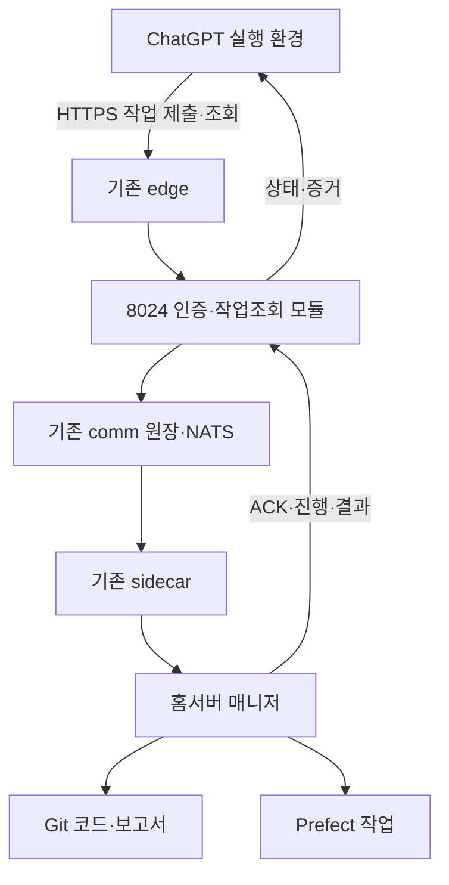

# ChatGPT에서 기존 통신망을 HTTP로 호출하기

## 1. 결정

ChatGPT 실행 환경에서 기존 서버로 HTTP 요청을 보내는 경로를 사용한다.
2026-11-05 이 세션에서 실제 응답을 확인했다. 전용 Telegram 플러그인이나 MCP는 이 경로의 필수 조건이 아니다.

기존 8024 Spring comm, NATS, sidecar, 매니저를 재사용한다.
외부 호출을 받는 작은 인증·작업조회 모듈을 8024에 추가하고 기존 edge에서 HTTPS로 연결한다.
새 통신 서버, 별도 포트, 새 메시지 브로커를 만들지 않는다.

외부 호출자의 전용 신원은 `chatgpt_architect`로 제안한다.
아직 등록하거나 인증키를 발급하지 않았으며 기존 봇 신원으로 대신 발신하지 않는다.

## 2. 이번 세션에서 확인한 사실

| 대상 | 확인 결과 | 확인 범위 |
|---|---|---|
| `http://43.201.34.144/` | HTTP 200, HTML 제목 MATRIX 홈 | 실제 화면 응답 |
| `http://43.201.34.144:8024/comm` | HTTP 200, 봇 통신 이력 화면 | 실제 화면 응답 |
| `http://43.201.34.144:8024/api/nats/brokers` | HTTP 200, connected=true, jetstream_up=true, total=624 | API가 보고한 브로커 연결 및 DB 원장 건수 |
| 위 API의 BOTLOG | messages=24, bytes=23434 | 조회 시점 수치, 이후 변경 가능 |
| 매니저 수신자 | `heav_lnx_bot`, roster active | Git 인사 원장 확인; 실행 중인 프로세스 확인은 아님 |
| 통신 담당 수신자 | `heav_lnx_codex_dev_1_bot`, roster active | Git 인사 원장 확인 |

HTTP 응답 성공은 작업 접수·매니저 각성·실행 성공의 증명이 아니다.
이번에는 읽기 전용 요청만 보냈다. send, ack, inbox 호출 및 봇 작업 발송은 하지 않았다.
조회 도구의 remote_ip가 로컬 프록시 주소로 표시되어 실제 서버 위치의 근거로 사용하지 않는다.
이번 세션의 도달성 확인이며 모든 향후 세션의 네트워크 접근을 보장하지 않는다.

## 3. 현재 구현과 맞춰야 할 점

근거:
- [통신 표준](../../../principles/telegram-comm-protocol-v1.md)
- [통신 클라이언트](../comm/comm_client.py)
- [sidecar 설치 문서](../comm/INSTALL-sidecar.md)
- [인사 원장](../roster.json)
- [NatsLogController 고정 버전](https://github.com/markjang29/matrix-studio-spring/blob/09264a546ecdf38174e39145a3bcbb9c9517b81d/src/main/java/com/matrix/studio/portal/NatsLogController.java)
- [NatsLogService 고정 버전](https://github.com/markjang29/matrix-studio-spring/blob/09264a546ecdf38174e39145a3bcbb9c9517b81d/src/main/java/com/matrix/studio/portal/NatsLogService.java)

코드 검토 결과이며 위 커밋과 실서버 바이너리의 일치는 아직 검증하지 않았다.

1. 기존 API는 `POST /api/nats/send`, `POST /api/nats/ack`, `GET /api/nats/whoami`, `GET /api/nats/inbox`를 제공한다.
2. inbox는 조회하면서 deliveredAt을 기록한다. 외부 호출자의 상태조회 및 연결 테스트에 사용하지 않는다.
3. 현재 comm-token은 공용이며 빈 값이면 검사를 생략한다. 외부 호출자는 전용 인증을 추가해야 한다. 현재 서버 토큰 설정 여부는 확인하지 않았다.
4. 기존 send는 매 요청 새 메시지 ID를 만든다. 응답 유실 후 동일 POST를 재시도하면 중복 작업이 될 수 있다.
5. 원장·배달장부 저장 실패를 로그로만 남기는 경로가 있다. 기존 ok=true 또는 brokered=true만으로 영속 접수·실행 완료를 판단할 수 없다.
6. messages는 조회용이지만 command_id 기준 결과·권한 조회 계약이 없다. from/to/q 복합 조건이 모두 적용되는 구현도 아니다.
7. sidecar wake는 수신과 별도 단계다. 메시지 수신, 실행 시작, 제출, 검수 완료를 구분한다.
8. 문서의 send 예제에는 key 인수가 있으나 현 comm_client.py의 send 계약과 일치하지 않는다. 신규 호출자는 이 예제를 그대로 복제하지 않는다.

## 4. 연결 구조



ChatGPT는 접근 가능한 HTTPS API를 호출한다. Telegram 봇 토큰과 cokacdir 각성키는 서버에 둔다.
매니저는 기존 방식으로 작업을 실행하며, 필요할 때만 Prefect 실행을 요청한다.
Prefect 서버나 NATS 포트를 ChatGPT에 직접 공개하지 않는다.
대화가 끝난 뒤의 실행·재시도·알림은 서버가 담당한다. ChatGPT가 계속 켜져 있는 것으로 설계하지 않는다.

## 5. 외부 호출 계약 — 신규 구현

기준 경로: `https://<검증된 기존 edge 도메인>/api/agent-bridge/v1`.
도메인·인증서·실제 upstream은 배포 담당자가 확정하고 결과 보고서에 기재한다.
이번에 확인한 평문 HTTP 주소는 도달성 확인용이며 전용 자격증명을 전송하는 운영 주소로 사용하지 않는다.

공통:
- `Authorization: Bearer <전용 자격증명>`; 토큰으로 발신자를 결정한다.
- 요청 body의 from으로 다른 발신자를 선택할 수 없다.
- 초기 허용 수신자는 매니저와 통신 담당 2명만. 방송 및 임의 명령 실행 API는 제공하지 않는다.
- 키는 배포 환경의 비밀 저장소/환경 설정에서 관리한다. Git, 대화 본문, URL query, 로그에 저장하지 않는다.
- 호출 환경에 자격증명을 안전하게 제공할 방법과 만료·폐기 방법을 배포 인계에 포함한다.

| API | 계약 |
|---|---|
| GET /health | 공개 최소 상태: service, version, ready. 토큰·주소·메시지 본문 제외 |
| GET /whoami | 인증된 actor, 허용 수신자, 권한. 다른 봇 우편함 접근 없음 |
| POST /commands | 작업 영속 접수. Idempotency-Key 필수. 성공 시 202와 command_id·status_url |
| GET /commands/{id} | 자신이 제출한 작업 상태·마지막 갱신·오류·증거 조회. 읽어도 배달 상태 불변 |
| GET /commands/{id}/events?after={cursor} | 자신의 작업 이벤트를 순번으로 재조회. 소비·ACK 효과 없음 |

제출 예시 — 값은 예시이며 실행된 작업이 아니다:

```json
{
  "to": "heav_lnx_bot",
  "kind": "status",
  "title": "Prefect 구현 상태와 미완료 항목 확인",
  "instruction": "지정한 명세 기준으로 현재 브랜치·테스트·실배포 상태를 읽기 전용으로 확인하고 증거를 보고한다.",
  "spec": {
    "repository": "markjang29/matrix-home",
    "path": "docs/architecture/prefect-project-orchestration-spec-v1.md",
    "commit": "d71c5985f1930f56890a75270fc7952127249745"
  },
  "constraints": {
    "read_only": true,
    "deploy": false,
    "merge": false
  }
}
```

kind 초기값은 status와 implement만 지원한다.
implement의 허용 저장소·작업 범위는 요청에 명시하고 수신자가 검증한다.
토큰 권한 자체가 모든 구현·배포에 대한 사용자 위임을 의미하지 않는다.

## 6. 기존 통신 규약 확장

### 신원

외부 서비스 신원을 Telegram 봇 계정과 구분한다.
Notes에 `projects/agent-ops/service-actors.json`을 추가하여
actor_id=chatgpt_architect, transport=http, wake=false, 허용 수신자, 상태를 등록한다.
8024의 검증은 기존 roster 봇과 서비스 신원을 구분하여 처리한다.
서비스 신원을 Telegram 동기화·전봇 방송·sidecar 각성 대상에 넣지 않는다.

### 제출과 중복 방지

- `(actor_id, Idempotency-Key)`에 유일 제약을 둔다.
- 수신자·요청 전체·명세 커밋을 정규화한 해시를 보존한다.
- 같은 키와 같은 내용은 기존 command_id 반환. 다른 내용은 409.
- command와 발송 outbox를 하나의 DB 트랜잭션으로 저장한 후 202를 반환한다.
- dispatcher는 기존 comm으로 type=task, ref=고정 명세, payload.command_id를 전달한다.
- 기존 send 경로에도 command_id 기반 원자적 중복 방지를 추가한다. 원장·수신 배달장부를 영속 저장한 뒤 접수 성공으로 처리한다.
- 브로커 전송과 DB 커밋 사이 장애는 outbox로 재처리한다. brokered=false는 완료가 아니다.
- 매니저도 command_id를 영속 저장하여 재배달 시 실제 작업을 중복 시작하지 않는다.
- 타임아웃을 빈 결과나 성공으로 바꾸지 않는다. 같은 키 재조회/재시도로 복구한다.

### 수신과 결과 회수

새 bridge 작업은 기존 inbox의 조회 즉시 소진 동작에 의존하지 않는다.
서버와 sidecar에 bridge 작업용 claim/lease 및 명시적 수신 확인을 추가한다.
수신자가 command_id와 처리할 내용을 영속 기록한 뒤 수신 확인하고, 확인 전 죽으면 lease 만료 후 재배달한다.
기존 일반 메시지의 동작은 이 작업에서 일괄 변경하지 않는다.

결과는 기존 type=ack/progress/blocked/submitted/review 메시지와 command_id를 연결하여 원장에 반영한다.
인증된 실제 수신자만 자기 작업 이벤트를 제출할 수 있고, event_id로 중복을 제거한다.
작업별 증가 sequence와 상태 전이 검증으로 늦게 온 progress가 완료 상태를 되돌리지 못하게 한다.

상태: accepted → dispatched → acknowledged → running → submitted → verified.
blocked와 failed에는 원인·재시도 가능 여부를 기록한다.
취소는 v1 범위 밖이며 요청 전송 중단을 원격 작업 취소로 표시하지 않는다.

- accepted: 작업과 outbox 영속 저장.
- dispatched: comm 배달장부 영속 저장.
- acknowledged: 수신자가 내용을 영속 수락.
- submitted: 구현자가 결과 제출. 테스트했다고 주장하는 단계와 검증 결과를 구분.
- verified: 별도의 허가된 검수 주체가 증거를 검증. 매니저의 완료 선언이나 Prefect Completed로 자동 승격 금지.

결과에는 repository, branch, full_commit_sha, 테스트 명령·exit code·보고서,
배포 여부·배포 버전·실측 시각, 필요시 prefect_run_id, 미완료 항목을 포함한다.
필수 값이 없으면 null과 누락 이유를 반환한다. 명세 전체나 큰 로그는 메시지에 복사하지 않고 Git/보고서 링크로 전달한다.

## 7. 구현 위치와 단계

| 단계 | 담당 작업 | 완료 증거 |
|---|---|---|
| C0 연결 | 기존 edge HTTPS, actor 인증·권한, health/whoami | 여기서 비밀 노출 없이 두 API 응답 확인 |
| C1 왕복 | 8024 command/outbox/조회, comm 중복 방지, sidecar 수신 보존, 결과 연결 | 읽기 전용 status 작업 1건의 접수→응답→증거 조회 |
| C2 운영 | 재시작 복구, 제한된 implement, 타임아웃·재시도·검수 | 아래 실패 시나리오 통과 및 허용 작업 1건 |

현재 통신 코드가 있는 matrix-studio-spring에서 최소 변경한다.
전체 Spring 제품 이관이나 Prefect 기능 완성을 이 연결의 선행 조건으로 두지 않는다.
Notes에는 계약·서비스 신원·검증 보고서만, 코드와 DB migration은 구현 저장소에 둔다.
기존 프로젝트 연결도에도 외부 호출자→edge→8024→sidecar→매니저 관계를 반영하되 계획/가동 상태를 구분한다.

## 8. 수용 기준

1. 무인증·잘못된 인증은 401; 다른 수신자·다른 작업 열람은 403 또는 404.
2. GET 상태를 반복해도 미수신 메시지 및 실행 상태가 바뀌지 않는다.
3. 동일 키 동시 POST 10건, 접수 응답 유실 후 재시도 모두 command와 실행이 1개다.
4. 같은 키·다른 내용은 409이며 기존 작업이 변경되지 않는다.
5. DB 저장 실패 시 202/ok=true가 나오지 않는다.
6. DB 접수 후 dispatcher 재시작, NATS 중단·복구 후 같은 command_id로 배달된다.
7. sidecar 수신 직후 종료 및 ACK 유실 시 재배달되며 매니저가 중복 실행하지 않는다.
8. 매니저 부재 시 accepted/dispatched를 유지하며 타임아웃 원인을 표시한다. 실행 중으로 꾸미지 않는다.
9. submitted 결과와 검수 결과가 구분되고, 늦은 이벤트가 상태를 역행시키지 않는다.
10. 허용된 status 요청 1건을 ChatGPT 실행 환경에서 제출하고 GET으로 같은 command_id의 결과·Git 근거를 읽는다.
11. 재시작 후 작업·이벤트·권한이 유지되고 인증키 폐기 즉시 후속 호출이 거절된다.
12. 응답·보고서·로그·Git에 자격증명이 없다.

## 9. 인계 시 제출할 항목

- 실제 HTTPS base URL, 구현 full commit, 배포 full commit 및 service version.
- 등록된 actor와 허용 수신자, 자격증명 보관 위치/전달 방식(값 제외).
- 테스트 command_id, ACK·결과 이벤트, 읽기 전용 상태조회 예시.
- 수용 기준별 pass/fail/not-run과 증거, 남은 제한.
- 기존 comm 사용자에게 미치는 영향 및 롤백 방법. 롤백 중에도 접수된 작업 원장은 보존.

현재 판정: HTTP 직접 호출과 통신 상태 조회는 가능하다.
전용 신원·인증·신뢰할 수 있는 작업 왕복 경로는 이 명세에 따라 구현하고 실증해야 한다.
