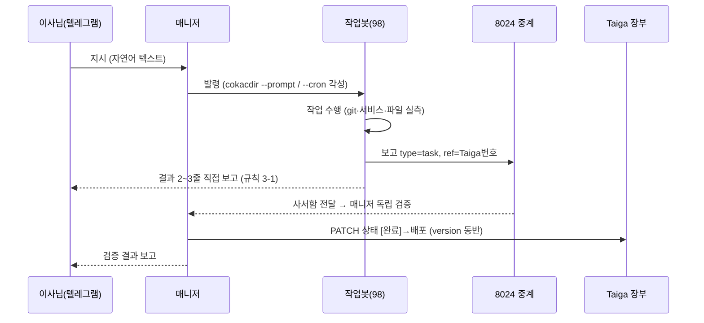
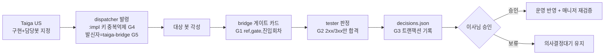

# 업무플로우 통신 도식 v1

> 이사님 10-27 확정: "업무플로우에 가까움 — 프로세스가 구분되서 통신하는지, 무슨 데이터를
> 전달하는지 등의 도식화."
> [topology-graph-v1.md](topology-graph-v1.md)이 **정적 구조**(무엇이 어디에 있나)라면
> 이 문서는 **동적 흐름**(누가 누구에게 무엇을 주고받나)이다. 상호보완 관계.

## 1. 프로세스 분리 (7개 주체)

| 주체 | 역할 | 위치 |
|---|---|---|
| 이사님 | 지시·승인·결정 | Telegram chat 8315615299 |
| 매니저(00 클로드) | 접수→발령→검증→장부→보고 | AWS 8G |
| 작업봇(98 코덱스 등) | 구현·조사·회신 | 홈서버 / AWS |
| 8024(matrix-studio-spring) | 메시지 중계·사서함·ACK (NATS JetStream) | 홈서버 |
| 사이드카 | 8024 폴링 → 자기 거점 봇 각성(wake) | firewin·gmwin·gmlnx·aws512 |
| taiga-bridge(dispatcher·bridge·tester) | 자동 발령·게이트·판정 | 홈서버 |
| Taiga | 업무 장부(유저스토리 상태) | 43.201.34.144:8040 |

분리 원칙: **지시(사람) / 관리(매니저) / 수행(작업봇) / 중계(8024) / 장부(Taiga)는 서로 다른
프로세스**다. 한 주체가 다른 주체 역할을 대행하지 않는다 (예: dispatcher는 발령만,
검증은 매니저만, 상태 이동은 매니저 확인 후만).

## 2. 표준 사이클 — 지시에서 완료까지

요약: 지시는 항상 텔레그램 → 매니저로 들어오고, 완료는 항상 매니저 검증을 거쳐 장부에
반영된 뒤 이사님께 보고된다. 작업봇이 장부 상태를 직접 바꾸지 않는다.

## 3. 자동 발령 사이클 — 게이트 (사람 승인 전 자동 구간)

## 4. 채널×데이터 전달표

| 채널 | 방향 | 페이로드 | 금지 |
|---|---|---|---|
| 텔레그램 지시 | 이사님→봇 | 자연어 텍스트 | — |
| cokacdir 발령 | 매니저→작업봇 | 작업 지시문 + 티켓번호 | — |
| 8024 보고 | 봇→매니저 | type=task, ref=Taiga번호, 본문 3줄 | 토큰값 |
| 규칙 3-1 직접 보고 | 봇→채팅 | 결과 2~3줄 | 토큰값 |
| ACK | 봇→8024 | acknowledged / blocked | — |
| wake(각성) | 사이드카→봇 | --cron 1m --once 프롬프트 | — |
| Taiga PATCH | 매니저→장부 | 상태ID(프로젝트별 상이) + version | 무단 상태 이동 |
| 크레덴셜 참조 | 모든 주체 | **파일 경로만** (예: comm-tokens.json) | **값 기록 전면 금지** |

## 5. 규칙 각주

- Taiga 상태 이동은 매니저 검증 후에만 (대기열 규칙 4). `claimed`는 완료가 아니고
  verified/closed는 컨트롤러만 발행한다.
- 상태 ID는 프로젝트마다 다르다 (예: 배포 = GOV 20 / PIPE 29 / INFRA 47) — cross-project
  착오 금지, 403의 주원인.
- 8024는 봇별 토큰 강제(N2). 토큰 값은 어느 채널에도 실지 않는다.
- 이 도식의 정본은 이 문서고, 수정은 매니저가 하되 큰 틀 변경은 이사님 보고 후.
